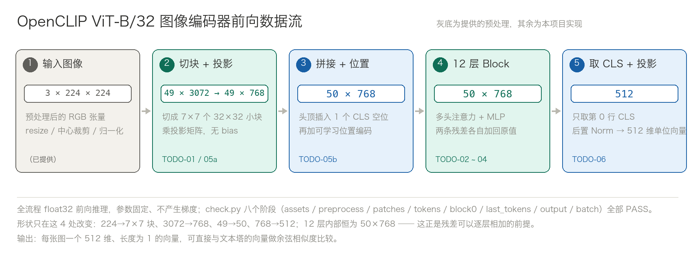

# Project 1 实验报告：用 NumPy 复现 OpenCLIP ViT-B/32 图像编码器前向

姓名：李采阳　|　学号：2025681061　|　日期：2026-11-24

代码：`image_encoder.py`（含中文注释）　运行说明：`README.md`　仓库：https://github.com/KeseraYoru/project1

## 1　完成情况与复现

仅用 NumPy 实现图像塔的完整前向：输入 `[B,3,224,224]`，输出每张图一个 512 维、长度为 1 的向量。六个 TODO 共 10 处空位、22 行代码全部完成，未使用 PyTorch / OpenCLIP 包，参数固定不更新、不含任何训练。`check.py --stage all` 八个阶段全部 PASS，`run.py` 产出 `(10,512)`。运行环境为 Python 3.14.3 + NumPy 2.5.4 + Pillow 13.0.0，CPU 推理，全部数组 float32。

```bash
python -m pip install -r requirements.txt
python check.py --stage all          # 八个阶段数值检查
python run.py --output output_tokens.npz
```

## 2　数据流：形状只在这四处改变



**图 1**　图像塔前向数据流，标注了每个阶段的形状与本项目对应的 TODO。

图像被切成 7×7 个 32×32 的块并投影到 768 维，头顶插入 1 个 CLS 空位后变 50 行，随后 12 层 Transformer 内部形状**恒为 50×768**——这正是两条残差可以逐层相加的前提；最后只取 CLS 那一行，经后置 Norm 与视觉投影压成 512 维并单位化。

## 3　分阶段数值误差

容差：preprocess 为 atol=2e-6，output / batch 为 atol=2e-5，内部阶段 2e-4，统一 rtol=2e-4。下表为 `check.py --stage all` 的原始输出。

| 阶段 | 输出形状 | max_abs | mean_abs | 判定 |
| --- | --- | --- | --- | --- |
| assets | 152 个张量 | — | — | PASS |
| preprocess | (10, 3, 224, 224) | 0.000e+00 | 0.000e+00 | PASS |
| patches | (2, 49, 3072) | 0.000e+00 | 0.000e+00 | PASS |
| tokens | (2, 50, 768) | 0.000e+00 | 0.000e+00 | PASS |
| block0 | (2, 50, 768) | 7.540e-06 | 2.274e-07 | PASS |
| last_tokens | (2, 50, 768) | 4.387e-05 | 2.406e-06 | PASS |
| output | (10, 512) | 6.780e-07 | 8.215e-08 | PASS |
| batch | (3, 512) | 4.619e-07 | 8.133e-08 | PASS |

**三点解读：** ① `patches` 与 `tokens` 误差为 0，因为这两段只做重排、展平和一次投影，没有逐层浮点累加；② 误差从 `block0`（7.5e-06）出现，随深度累积到 `last_tokens`（4.4e-05），仍比容差 2e-4 低近一个数量级；③ `output` 经单位化后数值回到 O(1)，绝对误差降至 6.8e-07，`batch` 阶段（顺序 `[1,0,1]`，同一张图出现两次）与 `output` 同量级，说明批量与重复图不影响正确性。

## 4　一个形状变化：patchify 的 `[B,3,224,224] → [B,49,3072]`

patch 为 32×32，224/32 = 7，故每张图 7×7 = 49 块；每块含 3 个 32×32 通道平面，摊平为 3×32×32 = 3072。编号顺序为**先左→右、再上→下**，块内按 **C→H→W** 摊平。三步全是零拷贝的视图操作，**只有最后一次 reshape 因内存不连续而真正复制一次**。

```python
b, c, h, w = images.shape
p = 32
nh, nw = h // p, w // p
grid = images.reshape(b, c, nh, p, nw, p)        # [B,C,块行,行内,块列,列内]
return grid.transpose(0, 2, 4, 1, 3, 5).reshape(b, nh * nw, c * p * p)   # ← 关键行
```

| 步骤 | 轴顺序 | 含义 |
| --- | --- | --- |
| 输入 | B, C, H, W | 通道优先的图像 |
| reshape | B, C, 块行, 行内, 块列, 列内 | H、W 各拆成「块号」与「块内位置」 |
| transpose(0,2,4,1,3,5) | B, 块行, 块列, C, 行内, 列内 | 把两个「块」轴提到一起 |
| reshape | B, 49, 3072 | 前两轴合成 patch 编号，后三轴合成像素编号 |

**关键在于通道轴 C 的位置**：它必须留在「块内」那一段的最前面。若把 C 挪到「块」之前，结果仍是 `[B,49,3072]`，`check.py` 不会报形状错，只会报数值不对，属于最难排查的一类错误。正确性用两种方式验证：4×4 玩具数组的 patch 0 恰为角点 `[0,1,4,5]`；真实输入下与「双层循环暴力切片」的结果 `array_equal` 为 True。

## 5　修过的一个 bug：keepdims 缺失导致广播失败

```python
x - x.mean(axis=-1)
# ValueError: operands could not be broadcast together with shapes (2,3) (2,)
```

`(2,3)` 沿 `axis=-1` 求均值后维度塌陷为 `(2,)`，广播从右往左对齐时 3 与 2 冲突。改为 **`x.mean(axis=-1, keepdims=True)`** 得到 `(2,3,1)`，保留的 1 可拉伸成 3，广播成立。`helpers.py` 中 LayerNorm 的 `(B,L,1)` 与 `(B,L,D)` 相减同理。

同类错误还有两处：**权重方向**——conv1 重排后是 `[out,in]`，直接 `patches @ W` 会报 core dimension 0 mismatch，必须写 `W.T`（除已是 `[in,out]` 的 `visual.proj` 外，本作业所有权重都需转置）；**dtype 提升**——缩放系数若写成 float64 标量，float32 结果会被整体提升为 float64 并触发 `AssertionError: use float32`，改用 `np.float32(1.0/np.sqrt(64))` 即修复。

## 6　关键实现点一览

| 位置 | 写法 | 形状 |
| --- | --- | --- |
| patchify | reshape + transpose(0,2,4,1,3,5) + reshape | [B,3,224,224] → [B,49,3072] |
| split_heads | `reshape(B,N,H,D/H).transpose(0,2,1,3)` | [B,N,768] → [B,12,N,64] |
| scores | `(q @ k.transpose(0,1,3,2)) * 0.125` | [B,12,N,N] |
| 加权与合并 | `coefficients @ v`，再 transpose(0,2,1,3) 拼回 | [B,12,N,64] → [B,N,768] |
| 输出投影 | `merged @ out_weight.T + out_bias` | [B,N,768] |
| 残差与 MLP | `residual = x + attn(norm1(x))`；`residual + gelu(u@W1.T+b1)@W2.T+b2` | [B,N,768] |
| patch 投影 | `patches @ patch_weight.T`（无 bias） | [B,49,3072] → [B,49,768] |
| CLS 与位置 | `concatenate([cls, patches], axis=1) + position` | [B,50,768] |
| 最终输出 | `unit_vector(post_norm(tokens[:,0,:]) @ proj)` | [B,768] → [B,512] |

q/k/v 由 `in_proj_weight` 一次投影后沿特征轴三等分；k 为四维，转置只交换最后两轴，写成 `.T` 会连带翻转 batch 与 head 分组。softmax、GELU、LayerNorm 与最终单位化均使用提供的 helper，以保证与 Torch 参考对齐。

## 7　贡献与协助

- **实现**：六处代码初稿由 AI 助手（WorkBuddy）给出，我逐条核对形状并运行验证；
- **定位**：按 `check.py` 阶段顺序找第一个不一致的阶段，再用 4×4 玩具数组确认 transpose 前后各轴的含义；
- **排错**：`keepdims` 广播、`@` 维度不匹配、`np.float64` 类型提升三类报错均单独复现并核对堆栈原文；
- **数据**：报告中全部误差数字取自 `check.py --stage all` 的原始输出，未手工调整；
- **声明**：未使用他人代码，未把 `assets/reference_outputs.npz` 当作输入或缓存结果，`output_tokens.npz` 由 `run.py` 现场计算。

## 8　参考

作业附件 `README.md`、`PPT-CODE-MAP.txt`、`transformer_steps.py`、`helpers.py` 注释，以及课堂讲义 76 页。
